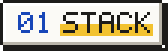

```text
   ____       _ _ _
  / ___|_   _(_) | |__   ___ _ __ _ __ ___   ___
 | |  _| | | | | | '_ \ / _ \ '__| '_ ` _ \ / _ \
 | |_| | |_| | | | | | |  __/ |  | | | | | |  __/
  \____|\__,_|_|_|_| |_|\___|_|  |_| |_| |_|\___|

 .-----------------------------------------------------------------------------.
 | (x) (-) (+)                     ~/about.txt                                 |
 |-----------------------------------------------------------------------------|
 |                                                                             |
 | Olá! Sou o Guilherme, Desenvolvedor Full Stack.                             |
 | Trabalho com Python, FastAPI, Rust, uso Docker e PostgreSQL                 |
 | nos meus projetos.                                                          |
 |                                                                             |
 | Projetos: Amor & Luz, Eventos e Ingressos e estudos de FastAPI.             |
 | -@CarvalhoGLC                                                               |
 |                                                                             |
 '-----------------------------------------------------------------------------'
```

<p></p>

<p>
  
</p>

<p></p>

<p>
  <a href="https://github.com/CarvalhoGLC"></a
  ><a href="https://www.linkedin.com/in/gclcosta/"></a
  ><a href="mailto:guilhermeclcosta@hotmail.com"></a>
</p>

```text
 guilherme@carvalhoglc ~ % exit
 logout
 Saving session...completed.

 [Process completed]▌
```
